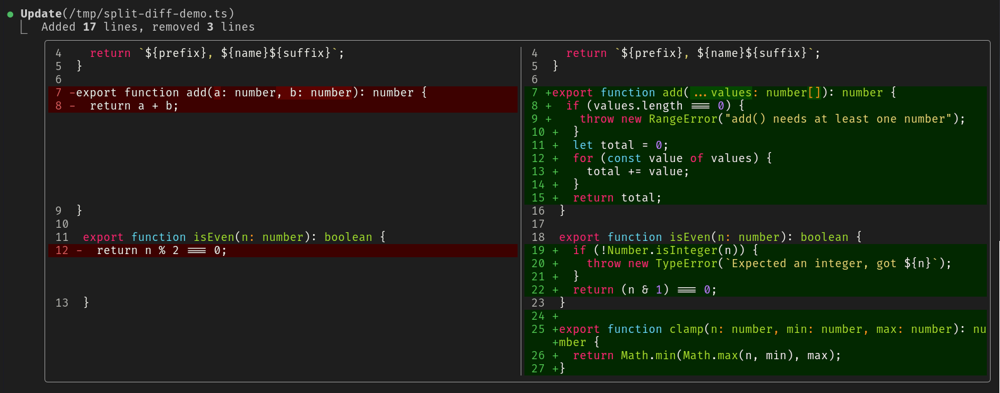
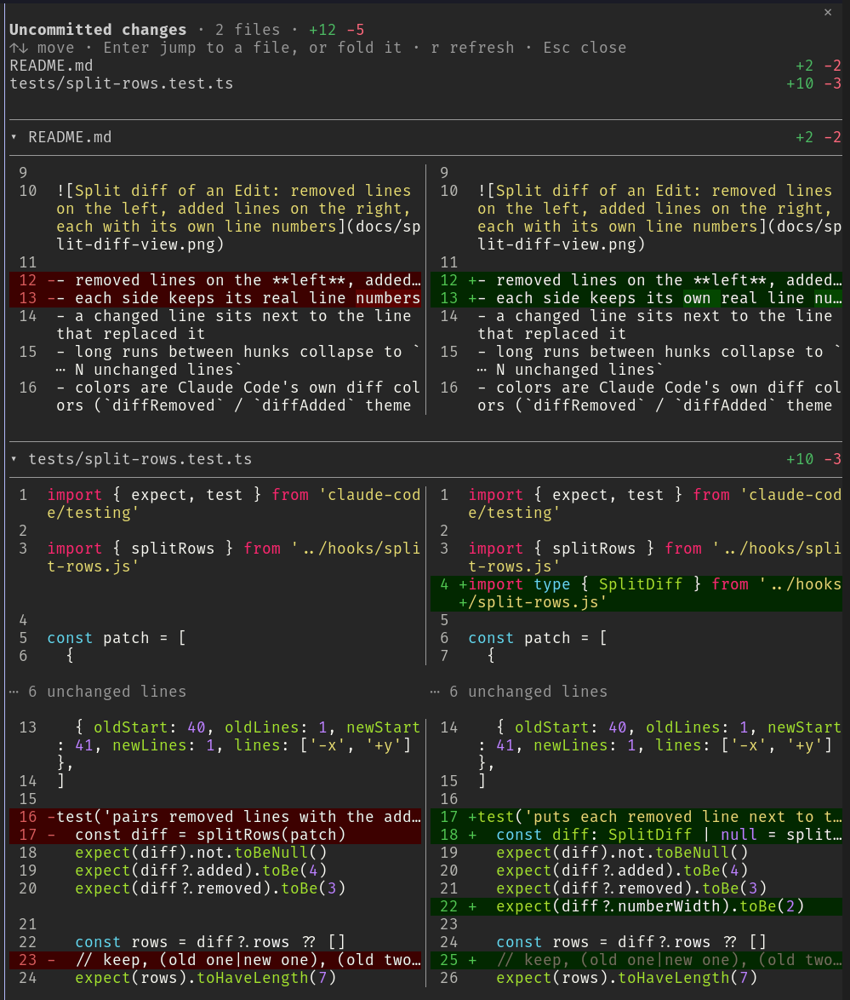

# Split diff view for Claude Code

[](https://mods.aidojo.si/mods/neteye-platform--cc-split-diff-view--cc-split-diff-view/)
[](https://mods.aidojo.si/mods/neteye-platform--cc-split-diff-view--cc-split-diff-view/)

A [Claude Code mod](https://code.claude.com/docs/en/plugins/mods/overview) that
draws the diff of every `Edit` and `Write` in **two side-by-side columns**
instead of one stacked `-`/`+` list:



- removed lines on the **left**, added lines on the **right**
- each side keeps its real line numbers
- a changed line sits next to the line that replaced it
- long runs between hunks collapse to `⋯ N unchanged lines`
- colors are Claude Code's own diff colors (`diffRemoved` / `diffAdded` theme
  keys), so they follow your `/theme`
- syntax highlighting comes from Claude Code's own highlighter (the `Code`
  element), with the language taken from the file's extension

Errors, edits held for review, brand-new files and anything without a diff
keep Claude Code's normal drawing.

## `/diffsplit`

Reviews all the uncommitted changes in one pane, with every diff in two
columns. It opens a pane titled **Split Diff** with the changes of the working
directory against `HEAD`, untracked files included:

- a list of the changed files comes first, each row ending with its `+n -n`
  counts; click a file, or press `Enter` on it, to jump to its diff
- under the list, every file is open: its name sits between two lines, with
  the counts at the end of the row, and its diff follows in two columns
- click a file's name, or press `Enter` on it, to fold or unfold that file
- `r` reloads the changes
- `Esc` closes the pane



Binary files are listed with `binary` and no diff. The pane reads the diff of
the first 100 files and draws a limited number of rows (at most 500 per file
and about 1200 in all); when a diff is cut it says `… N more rows`, and
folding other files makes room for it.

## Requirements

- Claude Code **v2.1.287 or later** (the version that introduced mods;
  they are on by default). Check with `claude --version`.
- Mods must be allowed to load: not started with `--safe-mode` or `--bare`,
  and not blocked by your organization's managed settings.

## Install

From a terminal:

```bash
claude plugin marketplace add neteye-platform/cc-split-diff-view
claude plugin install cc-split-diff-view@neteye-platform
```

Or from inside a Claude Code session:

```text
/plugin marketplace add neteye-platform/cc-split-diff-view
/plugin install cc-split-diff-view@neteye-platform
```

No download or build step is needed: Claude Code fetches the repository and
loads the TypeScript directly. Start a new session (or run `/reload-plugins`),
then ask Claude to edit a file.

To check it loaded, run `/plugin` and look for `cc-split-diff-view` under
**Installed**.

## Update

Claude Code caches an installed plugin by version, so updates arrive when the
`version` in `.claude-plugin/plugin.json` is bumped:

```bash
claude plugin marketplace update neteye-platform
```

## Uninstall

```bash
claude plugin uninstall cc-split-diff-view@neteye-platform
```

You can also turn it off without removing it from the **Installed** tab of
`/plugin`.

## Try it for one session without installing

```bash
git clone https://github.com/neteye-platform/cc-split-diff-view.git
claude --plugin-dir ./cc-split-diff-view
```

The mod hot-reloads when you save a file in that directory.

## Limitations

- Only `Edit` and `Write` are redrawn. The permission prompt is not a render
  site, so a mod cannot change it.
- Each line is highlighted on its own, so something that spans lines (a block
  comment or a template string) can be colored as plain code when only part of
  it is in the diff.
- Hooks stay active in the VS Code extension, `claude -p` and cloud sessions,
  but the interface part only draws in the terminal and the Desktop app's Code
  tab.
- Mod events and render-site props can change between Claude Code releases.
  If the diff suddenly looks like the default again, run
  `claude plugin validate .` and check the debug log.

## Credits

Developed by Oscar Zambotti ([@oskarnrk](https://github.com/oskarnrk)) in the
NetEye Platform development team, with Claude Code.

Listed on [Awesome Claude Code Mods](https://mods.aidojo.si/mods/neteye-platform--cc-split-diff-view--cc-split-diff-view/).
